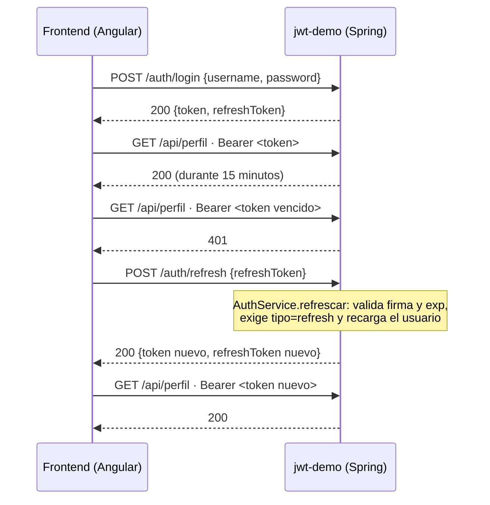

# Implementación: refresh token y soporte para el frontend

Este documento explica qué se agregó al backend `jwt-demo` para que el frontend Angular ([jwt-demo-front](../jwt-demo-front)) pueda usar **guards**, **interceptors** y **refresh token**. La explicación del lado del frontend está en [jwt-demo-front/IMPLEMENTACION.md](../jwt-demo-front/IMPLEMENTACION.md).

## El problema

El access token dura 15 minutos (`jwt.expiration-minutes`). Antes, cuando vencía, la única salida era volver a hacer login con usuario y contraseña. Ahora el login entrega **dos tokens**:

| | Access token (`token`) | Refresh token (`refreshToken`) |
|---|---|---|
| Duración | 15 minutos (`jwt.expiration-minutes`) | 7 días (`jwt.refresh-expiration-days`) |
| Se envía a | Toda la API, en `Authorization: Bearer …` | Solo `POST /auth/refresh`, en el cuerpo |
| Payload | `sub`, `roles`, `iss`, `iat`, `exp` | `sub`, `tipo: "refresh"`, `iss`, `iat`, `exp` |
| ¿Sirve para entrar a la API? | Sí | **No**: el filtro lo rechaza |

Los dos se firman con la misma clave HS256 y el mismo emisor; los distingue el claim `tipo`.

## Flujo

```
1. POST /auth/login     {username, password}  → 200 {token, refreshToken, tipo, expiraEnSegundos}
2. GET  /api/perfil     Bearer <token>         → 200 ... (15 minutos después) → 401
3. POST /auth/refresh   {refreshToken}         → 200 {token, refreshToken, ...}   (tokens nuevos)
4. GET  /api/perfil     Bearer <token nuevo>   → 200
   Si el refresh token venció o fue alterado: /auth/refresh responde 401 y hay que hacer login.
```

## ¿En qué momento se usa el refresh token?

**Solo cuando el access token deja de servir**, y quien lo dice es este backend: responde **401** cuando el access token falta, venció o fue alterado. El frontend reacciona a esa señal (o, al navegar, a que `exp` ya pasó); el refresh token no se envía en cada petición, porque así se expondría tanto como el access token.

Cómo leer las respuestas desde el cliente:

| Respuesta | ¿Refrescar? | Por qué |
|---|---|---|
| **401** de `/api/**` | **Sí**, una vez | El access token ya no sirve; el refresh token puede pedir otro. |
| **403** | No | El token es válido pero el rol no alcanza; un token nuevo trae el mismo rol (se recarga de la base de datos en `AuthService.refrescar`). |
| **401** de `/auth/refresh` | No | El refresh token venció, fue alterado o no es un refresh token: la sesión terminó y hay que hacer login. |

La explicación completa, con los tres momentos posibles (al recibir un 401, al navegar y antes de que venza), está en [jwt-demo-front/IMPLEMENTACION.md](../jwt-demo-front/IMPLEMENTACION.md#en-qué-momento-se-usa-el-refresh-token).

## Los tres flujos vistos desde el backend

El frontend tiene tres flujos (detallados en [jwt-demo-front/IMPLEMENTACION.md](../jwt-demo-front/IMPLEMENTACION.md#los-tres-flujos)). Esto es lo que ve este backend en cada uno:

| Flujo | Qué llega | Quién responde | Respuesta |
|---|---|---|---|
| **1 · Interceptor** (petición normal) | `GET /api/perfil` con `Authorization: Bearer <access token>` | `JwtAuthenticationFilter` valida firma, emisor y `exp`; `SecurityConfig` aplica las reglas | **200**, **401** (sin token o vencido) o **403** (sin el rol) |
| **2 · Guards** (navegar a `/admin`) | Nada mientras los guards deciden: la navegación ocurre en el navegador. Luego `GET /api/admin/usuarios` | `SecurityConfig`: `hasRole("ADMIN")` | **200** o **403**. Aunque alguien engañe al guard editando el token, la firma no coincide (**401**) o el rol real no es ADMIN (**403**) |
| **3 · Refresh** (el token vence) | 1) `GET /api/perfil` → **401**; 2) `POST /auth/refresh {refreshToken}`; 3) `GET /api/perfil` con el token nuevo | `AuthService.refrescar` y luego el filtro, como en el flujo 1 | **401**, luego **200** con tokens nuevos, luego **200**. Si el refresh token no sirve: **401** y el frontend manda al login |

### Diagrama de secuencia del refresh



## Teoría

Las preguntas que motivan esta implementación (sesión sin estado, quién pone el token, quién protege las rutas, si el cliente es confiable, cuánto debe durar un token, por qué dos tokens y cuándo refrescar) están explicadas en la sección [Teoría de jwt-demo-front/IMPLEMENTACION.md](../jwt-demo-front/IMPLEMENTACION.md#teoría-por-qué-existen-estas-piezas). La idea central para el backend: **el cliente no es confiable**, así que la firma, la expiración y los roles se validan aquí en cada petición, y el refresh token tiene su propio tipo (`tipo=refresh`) para que no sirva como access token.

## Cambios, archivo por archivo

| Archivo | Cambio |
|---|---|
| [application.properties](src/main/resources/application.properties) | Nuevas propiedades `jwt.refresh-expiration-days=7` y `cors.allowed-origin` (por defecto `http://localhost:4200`, se cambia con la variable `CORS_ALLOWED_ORIGIN`). |
| [JwtService](src/main/java/co/edu/javeriana/jwtdemo/security/JwtService.java) | Nuevo `generarRefreshToken(usuario)`: sin roles, con `tipo=refresh` y duración en días. Nuevo `esRefreshToken(claims)`. Busca `AQUÍ SE GENERA EL REFRESH TOKEN`. |
| [LoginResponse](src/main/java/co/edu/javeriana/jwtdemo/dto/LoginResponse.java) | Ahora es `(token, refreshToken, tipo, expiraEnSegundos)`. |
| [RefreshRequest](src/main/java/co/edu/javeriana/jwtdemo/dto/RefreshRequest.java) | **Nuevo.** Cuerpo de `/auth/refresh`: `{"refreshToken": "..."}`, obligatorio (`@NotBlank`). |
| [AuthService](src/main/java/co/edu/javeriana/jwtdemo/service/AuthService.java) | `login` entrega los dos tokens. Nuevo `refrescar(refreshToken)`: valida firma, emisor y expiración, confirma que sea `tipo=refresh` y **recarga al usuario de la base de datos**, así un cambio de rol se refleja en el siguiente access token. |
| [AuthController](src/main/java/co/edu/javeriana/jwtdemo/controller/AuthController.java) | Nuevo `POST /auth/refresh`. |
| [TokenInvalidoException](src/main/java/co/edu/javeriana/jwtdemo/exception/TokenInvalidoException.java) | **Nueva.** Refresh token alterado, vencido o que en realidad es un access token. |
| [GlobalExceptionHandler](src/main/java/co/edu/javeriana/jwtdemo/exception/GlobalExceptionHandler.java) | `TokenInvalidoException` → **401** con el mensaje en `{"error": "..."}`. |
| [JwtAuthenticationFilter](src/main/java/co/edu/javeriana/jwtdemo/security/JwtAuthenticationFilter.java) | Rechaza un refresh token enviado en `Authorization`. Antes, como no trae `roles`, habría producido un `NullPointerException`. |
| [SecurityConfig](src/main/java/co/edu/javeriana/jwtdemo/config/SecurityConfig.java) | `/auth/refresh` es público (el access token ya venció cuando se llama). Se activa **CORS** para el origen del frontend con los headers `Authorization` y `Content-Type`: sin esto el navegador bloquea las llamadas desde `localhost:4200`. |
| [JwtFlowTests](src/test/java/co/edu/javeriana/jwtdemo/JwtFlowTests.java) | Seis pruebas nuevas (ver abajo). Además se corrigió `tokenAlteradoResponde401`, que fallaba a veces: cambiaba el último carácter de la firma, cuyos bits finales Base64URL se descartan, así que a veces la firma quedaba igual. Ahora cambia el primero. |
| [peticiones.http](peticiones.http) | Peticiones para probar el refresh. |

## Respuestas de `/auth/refresh`

| Caso | Respuesta |
|---|---|
| Refresh token vigente | **200** con `token` y `refreshToken` nuevos |
| Refresh token vencido, alterado o mal formado | **401** `{"error": "Refresh token inválido o expirado"}` |
| Se envía un access token | **401** `{"error": "El token enviado no es un refresh token"}` |
| Cuerpo sin `refreshToken` | **400** |

## Pruebas

```bash
./mvnw test     # 16 pruebas, todas en JwtFlowTests
```

Pruebas nuevas:

- `refreshEntregaUnAccessTokenNuevoQueSirve`: el token que devuelve el refresh abre `/api/perfil`.
- `refreshConservaElRol`: el admin sigue entrando a `/api/admin/usuarios` con el token refrescado.
- `refreshTokenNoSirveComoAccessToken`: un refresh token en `Authorization` responde 401.
- `accessTokenNoSirveParaRefrescar`: un access token en `/auth/refresh` responde 401.
- `refreshTokenInvalidoResponde401`: token basura → 401; cuerpo vacío → 400.
- `corsPermiteElFrontendConElHeaderAuthorization`: el *preflight* desde `localhost:4200` se acepta.

## Ver el refresh en clase sin esperar 15 minutos

```bash
./mvnw spring-boot:run -Dspring-boot.run.arguments=--jwt.expiration-minutes=1
```

Con eso el access token vence en un minuto y en el frontend se ve el `401 → POST /auth/refresh → reintento` en la pestaña Red del navegador.

## Limitaciones (es una demo)

- **No hay revocación.** Un refresh token robado sirve hasta que vence (7 días), y hacer logout en el frontend no lo invalida en el servidor. En producción se guarda en la base de datos (o su identificador `jti`) para poder revocarlo, y se rota: cada refresh invalida el anterior.
- El frontend guarda los tokens en `localStorage`, que es simple pero queda expuesto a XSS. Una alternativa más segura es enviar el refresh token en una cookie `HttpOnly; Secure; SameSite`.
